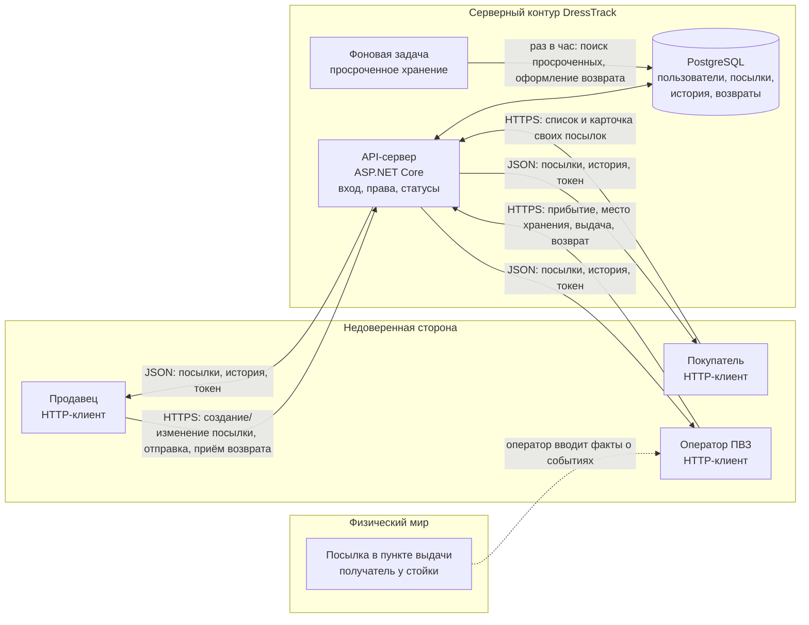

# Модель угроз

Продукт: DressTrack. Роли, сценарии и данные — в [паспорте](../S01/PROJECT.md),
требования — в [SECURITY_REQUIREMENTS.md](../S02/SECURITY_REQUIREMENTS.md).

## Модель продукта

Это единственный актуальный архитектурный вид проекта, другие документы ссылаются сюда.

**Точки входа (планируемый API):**

| Точка входа | Кто вызывает | Что приходит от клиента | Что меняется |
| --- | --- | --- | --- |
| `POST /auth/login` | Любой | Логин, пароль | Выдаётся токен |
| `GET /health` | Любой | — | — |
| `GET /parcels`, `GET /parcels/{id}`, `GET /parcels/{id}/history` | Все роли | id посылки, фильтр | — |
| `POST /parcels` | Продавец | Номер заказа, получатель, пункт, состав, стоимость | Новая посылка |
| `PUT /parcels/{id}` | Продавец | id, состав, получатель, пункт | Данные посылки |
| `POST /parcels/{id}/cancel`, `/ship`, `/returned` | Продавец | id | Статус, история |
| `POST /parcels/{id}/arrive` | Оператор | id, место хранения | Статус, место и срок хранения |
| `POST /parcels/{id}/issue` | Оператор | id, подтверждение получателя | Статус, история |
| `POST /parcels/{id}/return` | Оператор | id, причина, комментарий | Статус, заявка на возврат |

Все решения о правах, допустимости перехода и сроке хранения принимает API-сервер.
Фоновая задача работает внутри серверного контура и берёт время только с часов сервера.

**Что уже существует:** паспорт и требования безопасности; кода пока нет.

**Что пока планируется:** весь серверный контур со схемы — API, фоновая задача, база данных.

**Существенные допущения:**

- база данных доступна только API-серверу и фоновой задаче, наружу не открыта;
- учётные записи и привязки (магазин продавца, пункт оператора) создаются начальными данными;
- часы сервера считаются доверенными;
- один экземпляр сервера, но запросы обрабатываются параллельно;
- служба доставки и сайт магазина с сервисом не взаимодействуют.

## Границы доверия

| Граница | Что пересекает | Почему требуется проверка |
| --- | --- | --- |
| TB-1. HTTP-клиент → API-сервер | Логин и пароль, токен, id посылок, тело запросов (состав, получатель, пункт, место хранения, причина), любые лишние поля | Клиент полностью под контролем пользователя: Swagger и Postman позволяют отправить любой запрос, в том числе не предусмотренный его ролью, с чужим id или с дополнительными полями (`status`, `storeId`, срок хранения, автор). Сервер сам определяет пользователя по токену и сам решает, допустимо ли действие |
| TB-2. Физический мир → оператор → сервис | Утверждения оператора о физических событиях: посылка пришла, посылку забрал получатель, получатель отказался | Сервис не видит пункт выдачи. Оператор может ошибиться или действовать недобросовестно, поэтому отметка о выдаче не должна держаться только на его слове |

Граница API-сервер → база данных внутри серверного контура; по допущению выше база
доступна только серверу и в этой модели не анализируется.

## Значимые объекты и свойства

Объекты и последствия нарушения — в [разделе 5 паспорта](../S01/PROJECT.md#5-значимые-данные-и-другие-объекты).
Для модели главное:

- **конфиденциальность** посылки и данных получателя — каждый видит только своё;
- **целостность статуса и истории** — статус отражает реальное событие, история показывает,
  кто и когда его изменил;
- **неизменность состава, получателя и пункта** после отправки;
- **подлинность пользователя** — от его имени нельзя действовать без входа;
- **доступность** — продавец может отправлять, покупатель видеть, оператор выдавать посылки.

## Угрозы

| ID | Сценарий угрозы | Что нарушается | Граница / точка входа | Связанные SR | Приоритет и обоснование |
| --- | --- | --- | --- | --- | --- |
| T-01 | Покупатель (или любой вошедший) перебирает id в `GET /parcels/{id}` и `/history` и получает чужие посылки: имя, телефон, состав, стоимость, пункт выдачи | Конфиденциальность посылки и персональных данных | TB-1, `GET /parcels/{id}` | SR-01 | **Высокий, в наборе.** Делается одним изменённым запросом, затрагивает основной сценарий отслеживания и персональные данные |
| T-02 | Оператор пункта 2 подставляет id посылки пункта 1 в `/issue` или `/return`; продавец магазина 2 — id посылки магазина 1 в `/cancel` или `PUT`. Роль подходит, но посылка чужая | Целостность статуса и данных чужой посылки | TB-1, `/issue`, `/return`, `/cancel`, `PUT /parcels/{id}` | SR-10, SR-02 | **Высокий, в наборе.** Проверка только роли пропускает этот запрос. Ложное «Выдано» скрывает пропажу посылки в другом пункте |
| T-03 | Покупатель видит в Swagger операции оператора и вызывает `/issue` или `/return` для своей посылки напрямую, хотя в его «окне» таких действий нет | Целостность статуса, полномочия ролей | TB-1, `/issue`, `/return` | SR-02 | **Средний.** Реалистично, но вред ограничен своей посылкой, а проверка роли — базовая и будет первой в реализации |
| T-04 | Продавец или оператор добавляет в тело `PUT /parcels/{id}` или `/arrive` поля, которых нет в форме: `status: "Выдано"`, `storeId`, `recipientId`, `storageDeadline`, `changedBy`. Сервер переносит их в объект целиком | Переходы статусов, привязки посылки, неизменность после отправки, срок хранения, авторство в истории | TB-1, `PUT /parcels/{id}`, `/arrive` | SR-03, SR-04, SR-05, SR-06, SR-07 | **Высокий, в наборе.** Один запрос обходит сразу несколько требований; влияет на то, как сервер принимает данные во всех операциях изменения |
| T-05 | Оператор отмечает выдачу просроченной посылки в промежутке до запуска фоновой задачи или передаёт свой `storageDeadline` при прибытии, чтобы продлить хранение | Срок хранения, согласованность статуса с учётом магазина | TB-1, `/issue`, `/arrive` | SR-06 | **Средний.** Нужен недобросовестный оператор и узкое окно времени; часть сценария перекрыта T-04 |
| T-06 | Оператор отмечает «Выдано» в тот же момент, когда фоновая задача оформляет возврат по истёкшему сроку. Оба запроса по отдельности корректны, но выполняются одновременно, и посылка получает оба перехода | Согласованность статуса: посылка одновременно выдана и возвращается | `/issue` и фоновая задача | SR-03, SR-07 | **Средний.** Редкое совпадение, но последствия — противоречивый учёт; влияет на то, как сервер выполняет переходы |
| T-07 | Оператор отмечает «Выдано», хотя получатель не приходил: забрал посылку себе или отдал постороннему. Покупатель видит «Выдано» и не может доказать, что не получал | Целостность статуса, подлинность факта выдачи | TB-2, `/issue` | SR-11, SR-07 | **Высокий, в наборе.** Сейчас выдача держится только на слове оператора; дорогие вещи — реальная мотивация; требует изменения сценария выдачи |
| T-08 | Посторонний подбирает пароль оператора через `POST /auth/login` и получает его права: видит посылки пункта и может отмечать выдачу | Подлинность пользователя, затем всё, что доступно оператору | TB-1, `/auth/login` | SR-09 | **Средний.** Последствия высокие, но в учебной системе мало аккаунтов и ограничение попыток уже заложено в требования |
| T-09 | Оператор получает стоимость вещей из полей ответа `GET /parcels`, если сервер отдаёт объект посылки целиком, и выбирает дорогие посылки | Конфиденциальность стоимости | TB-1, `GET /parcels` | SR-08 | **Низкий.** Оператор и так физически видит посылки; вред — повышенный риск кражи |
| T-10 | Продавец (или тот, кто вошёл под его аккаунтом) создаёт тысячи посылок или посылку с огромным составом, и база и списки перестают нормально работать | Доступность сервиса | TB-1, `POST /parcels` | — (разрыв) | **Низкий.** Нужен вошедший продавец, а вред обратим. SR пока не добавлен, решу на S04 |

## Приоритетный набор

**T-01, T-02, T-04, T-07.**

- T-01 и T-02 — основные сценарии (отслеживание и выдача), выполняются одним запросом
  с изменённым id и затрагивают чужие посылки.
- T-04 обходит сразу несколько требований одним запросом и определяет, как сервер должен
  принимать данные во всех операциях изменения.
- T-07 — единственная угроза через границу TB-2; без изменения сценария выдачи её не
  закрыть, поэтому решение нужно уже в текущей архитектуре.

T-03, T-05, T-06 и T-08 остаются средними: вред ограничен или сценарий маловероятен,
но они будут проверены вместе с решениями по набору.

## Что доработать к S04

- T-10: решить, нужен ли SR на ограничение объёма создаваемых данных.
- Проверить, не стоит ли поднять T-06 в приоритетный набор, если переходы будут
  выполняться без блокировки.
- После выбора решений добавить связи `D-*` в требования.
